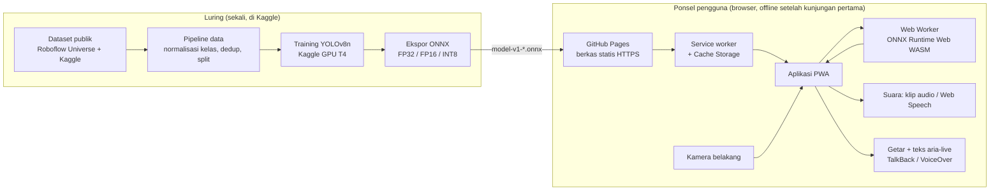
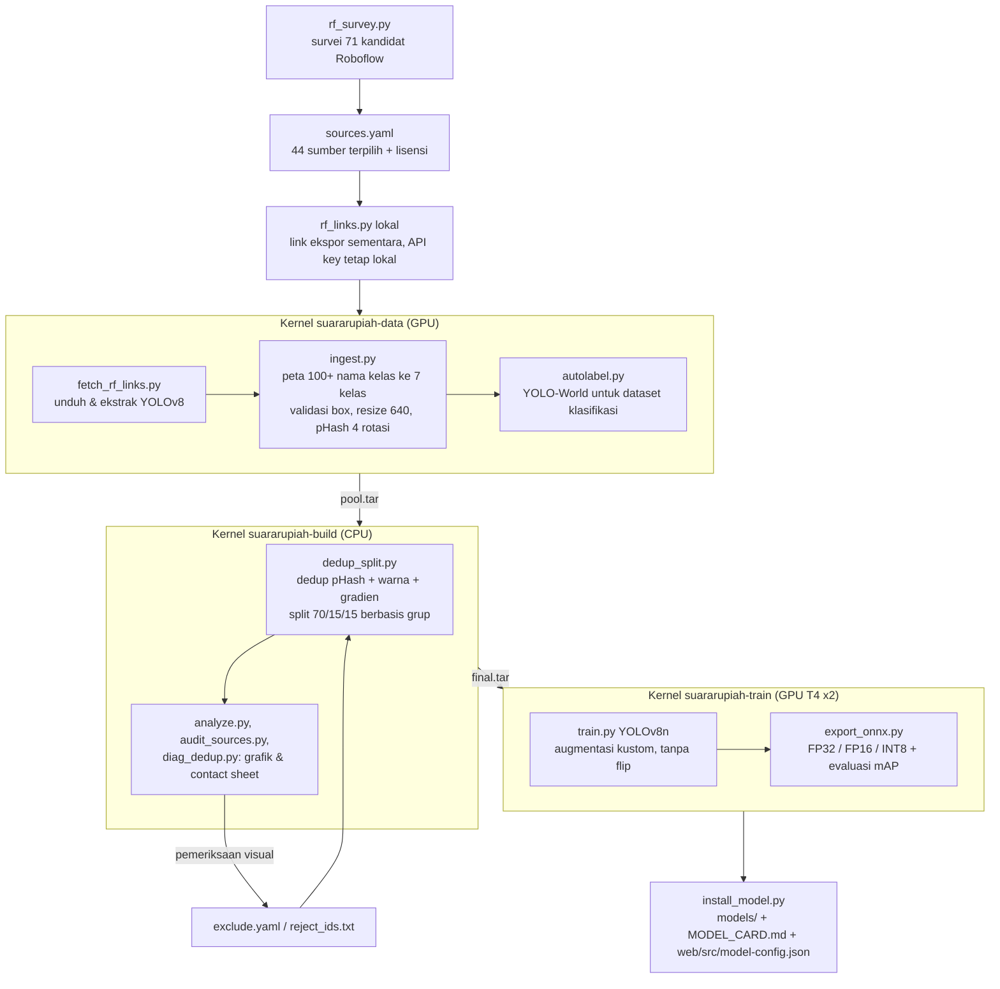
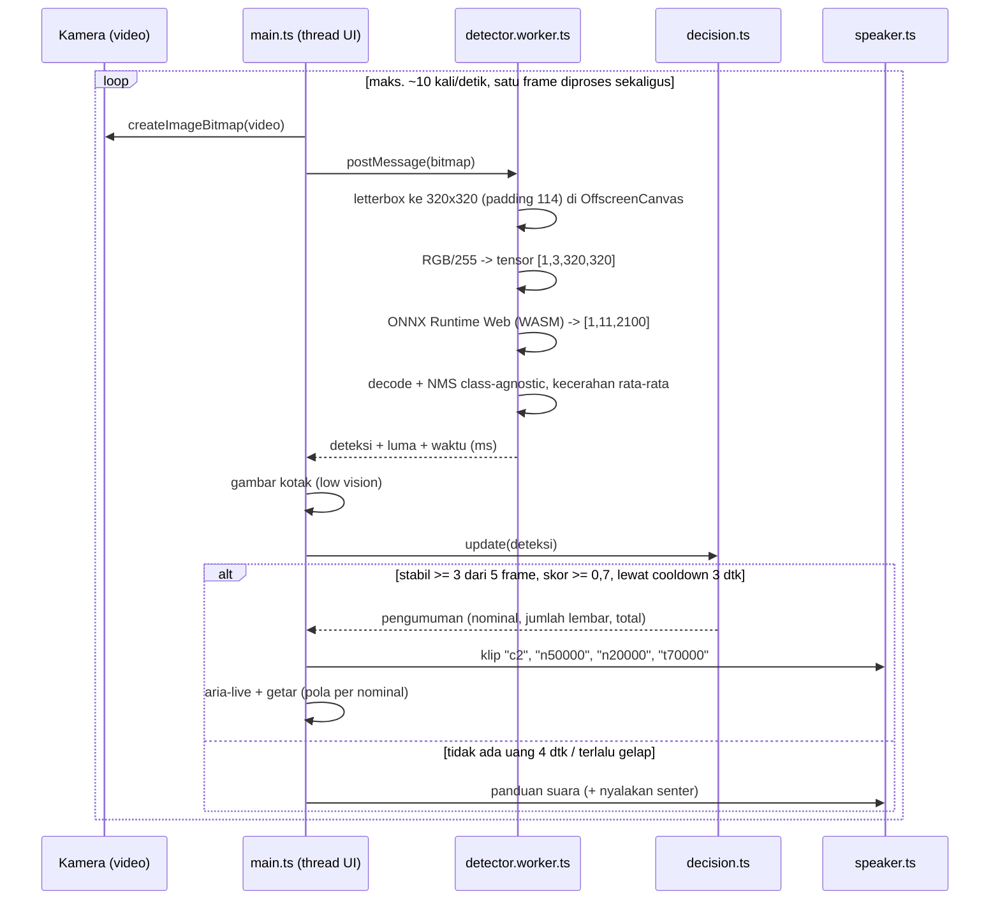

# Arsitektur SuaraRupiah

Dokumen ini menjelaskan alur data dari dataset sampai suara keluar di ponsel pengguna.

## 1. Gambaran besar

Tidak ada server inferensi. GitHub Pages hanya menyajikan berkas statis (HTML, JS, WASM, model, audio).
Gambar kamera tidak pernah meninggalkan ponsel.

## 2. Pipeline data & training (folder `training/`)

## 3. Alur per frame di aplikasi (folder `web/src/`)

## 4. Komponen web

| Berkas | Tugas |
|---|---|
| `src/main.ts` | Boot (kamera, unduh model + WASM dengan progres, siap), loop frame, pengumuman, ketuk untuk ulang |
| `src/worker/detector.worker.ts` | Inferensi di Web Worker: letterbox, normalisasi, ONNX Runtime Web, decode + NMS |
| `src/lib/letterbox.ts`, `postprocess.ts` | Fungsi murni pra/pasca-proses (diuji unit, sama dengan `infer_ref.py`) |
| `src/lib/decision.ts` | Voting 3 dari 5 frame, threshold, cooldown, reset saat uang hilang; panduan "belum terdeteksi" & "gelap" |
| `src/lib/phrases.ts`, `numwords.ts` | Susunan kalimat (jumlah lembar, masing-masing, total), angka ke kata, pola getar |
| `src/app/speaker.ts` | Putar klip MP3 (Web Audio), cadangan Web Speech API `id-ID` |
| `src/app/loader.ts` | Unduh model & WASM dengan progres, simpan di Cache Storage (offline), hapus cache versi lama |
| `src/app/camera.ts` | Kamera belakang (`facingMode: environment`), senter (`torch`) bila didukung |
| `vite.config.ts` | Build multi-halaman (`/`, `/about/`, `/benchmark/`) + PWA (manifest, service worker Workbox) |

## 5. Strategi offline & pembaruan model

- **Service worker (Workbox)** mem-precache HTML, JS, CSS, ikon, manifest, dan semua klip audio.
- **Model ONNX & runtime WASM** disimpan sendiri oleh aplikasi di Cache Storage (`suararupiah-asset-model-<versi>-<varian>`,
  `suararupiah-asset-ort-<versi ORT>`), agar progres unduhan bisa ditampilkan dan berkas tidak terunduh dua kali.
- Nama model berversi (`model-v1-<varian>.onnx`). Model baru = versi baru: cache baru dibuat, cache lama dihapus saat aplikasi dibuka.
- Setelah kunjungan pertama, aplikasi berjalan tanpa internet (diuji E2E dengan mode offline).

## 6. Keputusan teknis penting

| Keputusan | Alasan |
|---|---|
| Inferensi di browser (WASM) | Privasi (tanpa unggah gambar), offline, tanpa biaya server |
| Web Worker | Inferensi 50 sampai 300 ms per frame tidak membekukan UI/suara |
| Satu frame diproses sekaligus | Laju inferensi otomatis menyesuaikan kemampuan perangkat |
| NMS class-agnostic | Satu lembar uang tidak boleh punya dua nominal |
| Voting 3/5 + threshold 0,7 | Menekan salah sebut akibat frame buram/transisi |
| Klip audio + cadangan Web Speech | Suara konsisten & offline; klip mudah diganti rekaman manusia (nama berkas sama) |
| GitHub Pages | HTTPS gratis; keterbatasan: tanpa header COOP/COEP sehingga WASM hanya 1 thread (diukur di laporan) |
