# Laporan Evaluasi SuaraRupiah

Dokumen ini dibangkitkan oleh `training/scripts/make_report.py` dari berkas hasil eksekusi (log/JSON di repo dan output kernel Kaggle). Strukturnya mengikuti Bab 4 laporan capstone.

## 4.1 Dataset

Dataset dibangun dari **37 sumber** yang lolos seleksi lisensi (daftar & atribusi: `docs/SUMBER_DATASET.md`).

| Tahap | Jumlah citra |
|---|---|
| Pool setelah normalisasi kelas | 69.624 |
| Dibuang: `duplicate` | 23.450 |
| Dibuang: `excluded_source` | 6.979 |
| Dibuang: `neg_quota` | 1.899 |
| Dibuang: `status_al_reject_nobox` | 579 |
| Dibuang: `status_al_reject_lowconf` | 514 |
| Dibuang: `label_conflict` | 258 |
| Dibuang: `status_fix_drop` | 42 |
| Dibuang: `duplicate_count_mismatch` | 41 |
| **Dataset final** | **35.862** |
| Kelompok kemiripan (unit split) | 8.789 |

Pembagian 70/15/15 berbasis kelompok dan stratified per kelas:

| Split | Citra | Negatif | Rp1.000 | Rp2.000 | Rp5.000 | Rp10.000 | Rp20.000 | Rp50.000 | Rp100.000 |
|---|---|---|---|---|---|---|---|---|---|
| train | 26461 | 2510 | 3236 | 2974 | 4196 | 4046 | 3678 | 4371 | 4143 |
| val | 4858 | 538 | 659 | 633 | 634 | 632 | 642 | 653 | 606 |
| test | 4543 | 538 | 674 | 638 | 641 | 639 | 645 | 667 | 615 |

(angka per kelas = jumlah objek/bounding box)

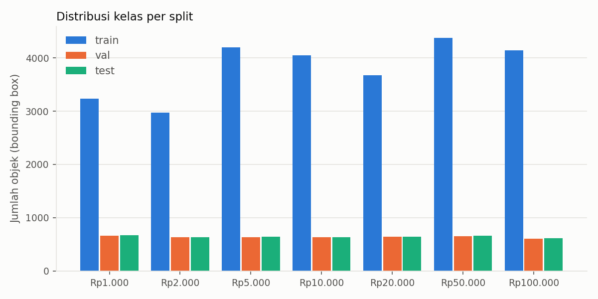

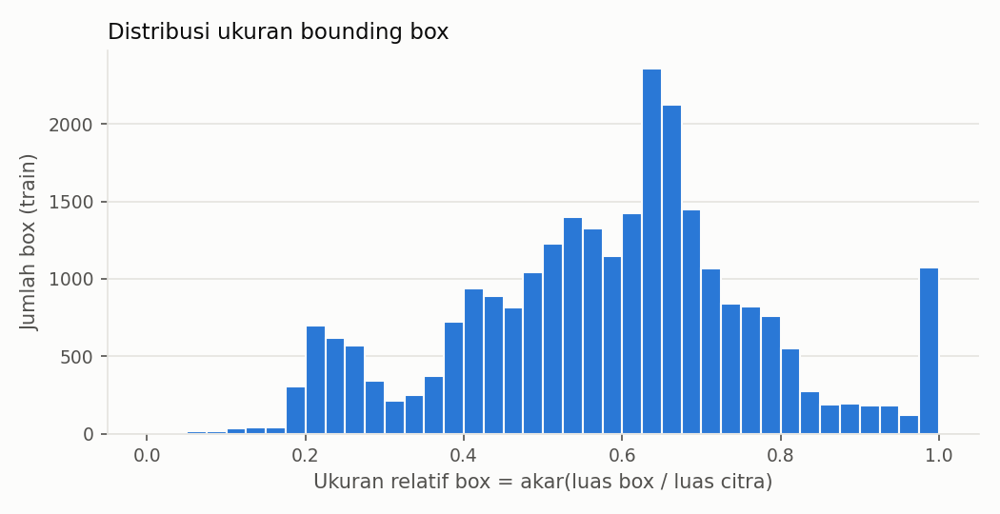

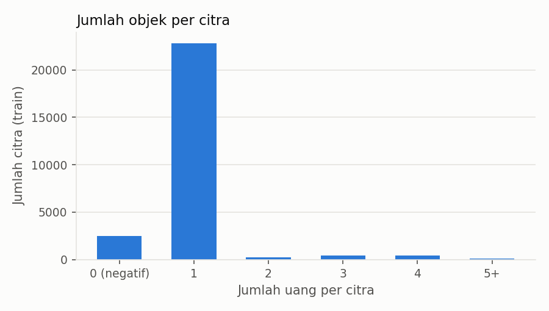

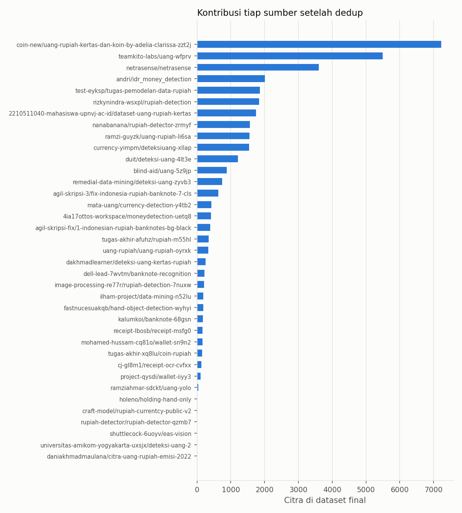

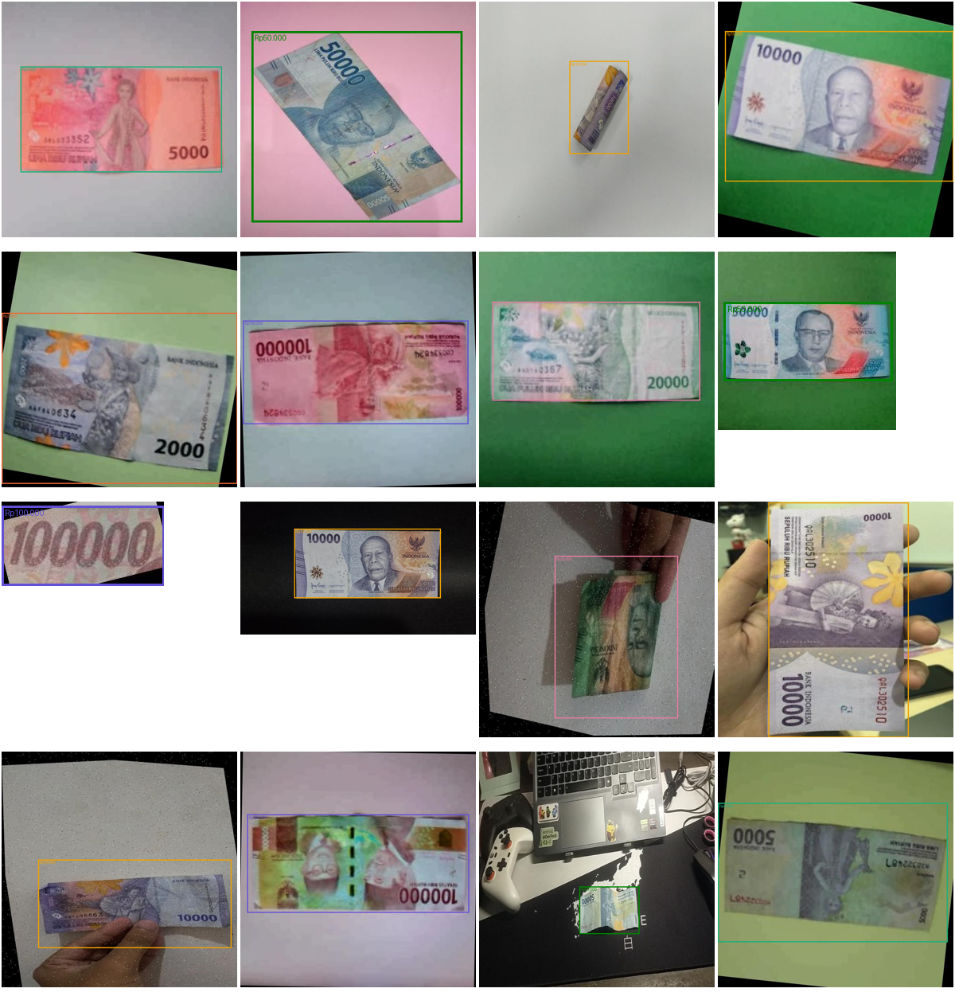

### Pembersihan data

Pool awal 69.624 citra dari 44 sumber Roboflow dan 1 dataset Kaggle menyusut menjadi 35.862 citra (data D4) melalui
empat iterasi. Alasan setiap iterasi dicatat di `docs/EKSPERIMEN.md`. Ringkasnya:

1. **Normalisasi kelas dan validasi box.** Ratusan variasi nama kelas (`10rb`, `Rp. 10.000`, `SEPULUH RIBU ASLI`, dan
   seterusnya) dipetakan ke 7 nominal. Box koin dan Rp75.000 dijadikan latar.
2. **Auto-label.** Dataset Kaggle berbentuk klasifikasi (tanpa box) diberi box oleh YOLO-World. Hanya 307 dari 1.400
   citra yang diterima: 579 tanpa box dan 514 dengan confidence rendah dibuang.
3. **Penghapusan duplikat** dengan pHash pada 4 rotasi, ditambah ciri warna dan gradien, secara serakah non-transitif.
   Foto identik dengan label berbeda dibuang sebagai konflik label (258 citra). Pemeriksaan visual menunjukkan
   sebagian besar konflik adalah salah label sungguhan berpola "salah jumlah nol", misalnya Rp1.000 ditulis 10000.
4. **Sumber dikeluarkan** karena gaya anotasinya tidak cocok dengan tugas deteksi per lembar: anotasi per-bagian uang,
   foto lampu UV, dan koin berlabel uang kertas. Box bagian yang bersarang di dalam box sekelas yang lebih besar juga
   dibuang (11.359 box).
5. **Audit berbasis model** (model e0): 65 label berpola salah-nol dikoreksi, dan 42 citra train dengan kelas meragukan
   dibuang. Sebanyak 63 kasus meragukan yang tidak sistematis di val/test sengaja **dibiarkan** agar evaluasi tidak bias
   ke model; akibatnya angka test sedikit pesimistis.
6. **Split 70/15/15 berbasis kelompok kemiripan** sehingga foto yang mirip tidak muncul sekaligus di train dan test.
   Negatif (uang asing, dompet, struk, tangan, koin) dibatasi kuota 10%.


## 4.2 Konfigurasi training

| Parameter | Nilai |
|---|---|
| Model | YOLOv8n (bobot awal COCO `yolov8n.pt`), Ultralytics 8.3.253 |
| Ukuran input | 320 x 320 |
| Epoch | 80 dijalankan (maks. 80, early stopping patience 20); epoch terbaik 80 |
| Batch | 64 |
| Waktu training | 2,5 jam (GPU NVIDIA Tesla T4, Kaggle) |
| Augmentasi geometri | rotasi bebas ±180°, translate 0.1, skala 0.5, shear 2.0, perspektif 0.0005, mosaic 1.0 (dimatikan 10 epoch terakhir) |
| Augmentasi warna | hue ±0.005 (kecil, warna = ciri nominal), saturasi 0.5, value 0.4 |
| Flip | horizontal 0.0, vertikal 0.0 (tidak dipakai) |
| Augmentasi kustom | tekstur kusut + lipatan (p=0,25), oklusi jari (p=0,2), cahaya redup (p=0,12), motion blur, noise, brightness/contrast, gamma, kompresi JPEG, downscale |

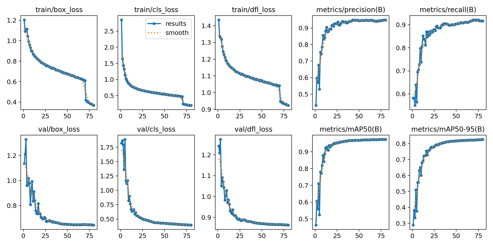

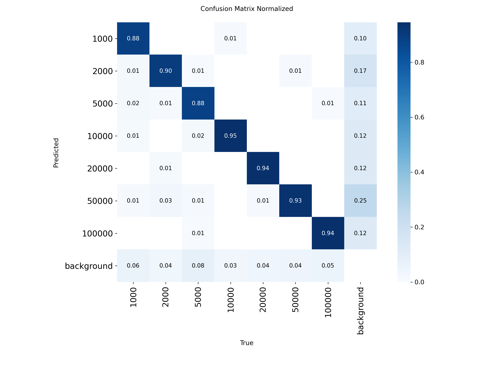

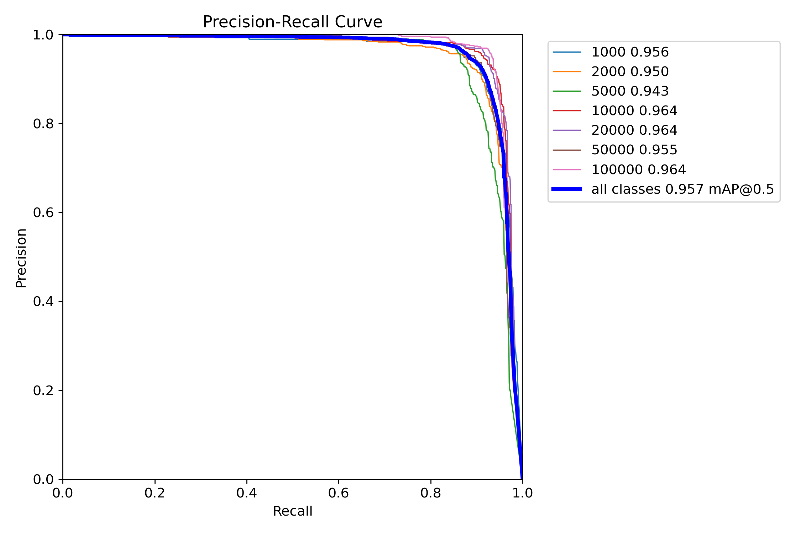

## 4.3 Tabel eksperimen

Angka validator Ultralytics bawaan (`rect=True`, cenderung optimistis; lihat 4.4):

| Run | imgsz | Epoch | mAP50 val | mAP50 test | mAP50-95 test | Precision test | Recall test |
|---|---|---|---|---|---|---|---|
| e1_r320 | 320 | 80 | 0,9733 | 0,9566 | 0,8056 | 0,9535 | 0,8936 |
| e1_r416 | 416 | 80 | 0,9785 | 0,9614 | 0,8107 | 0,9487 | 0,9111 |
| e2_r320_hn | 320 | 40 | 0,9717 | 0,9548 | 0,8057 | 0,9522 | 0,8942 |

mAP **pipeline aplikasi web** (ONNX, `eval_onnx_map.py`) pada split test yang sama:

| Model | Citra | mAP50 | mAP50-95 | Precision | Recall |
|---|---|---|---|---|---|
| `model-v1-fp32.onnx` (e1_r320) | 4543 | 0,9154 | 0,6771 | 0,9277 | 0,8866 |
| `model-v1-fp16.onnx` (e1_r320) | 4543 | 0,9154 | 0,6773 | 0,9279 | 0,8870 |
| `model-v2-fp32.onnx` (e2_r320_hn) | 4543 | 0,9304 | 0,6890 | 0,9389 | 0,8980 |
| `model-v2-fp16.onnx` (e2_r320_hn) | 4543 | 0,9304 | 0,6888 | 0,9392 | 0,8976 |

Riwayat lengkap & alasan setiap perubahan (termasuk aturan adopsi ronde v2): `docs/EKSPERIMEN.md`.

## 4.4 Metrik akhir model terpilih

Model web terpilih `model-v1-fp16.onnx` (run **e1_r320**) dengan **pipeline aplikasi web** (letterbox tengah, NMS class-agnostic, `eval_onnx_map.py`) pada split test (4543 citra): mAP50 **0,9154**, mAP50-95 **0,6773**, precision **0,9279**, recall **0,8870**. Target mAP50 ≥ 0,90: **tercapai**. Angka ini dipakai sebagai angka utama.

Sebagai pembanding, validator Ultralytics bawaan (`rect=True`) memberi mAP50 0,9566 / mAP50-95 0,8056 untuk bobot PyTorch yang sama; selisihnya dibahas di `docs/EKSPERIMEN.md` (catatan protokol).

| Kelas | AP50 pipeline web | AP50 validator Ultralytics | AP50-95 validator Ultralytics |
|---|---|---|---|
| Rp1.000 | 0,8815 | 0,9560 | 0,8103 |
| Rp2.000 | 0,8880 | 0,9498 | 0,8174 |
| Rp5.000 | 0,9149 | 0,9431 | 0,7954 |
| Rp10.000 | 0,9210 | 0,9639 | 0,8137 |
| Rp20.000 | 0,9252 | 0,9642 | 0,7859 |
| Rp50.000 | 0,9359 | 0,9548 | 0,8013 |
| Rp100.000 | 0,9411 | 0,9642 | 0,8148 |

## 4.5 Hasil uji per kondisi

Model web (`model-v1-fp16.onnx`), ambang pengumuman 0,70. Akurasi = persentase citra yang nominal-nominalnya diumumkan persis benar (untuk `bukan_rupiah`: tidak ada nominal yang diumumkan).

| Kondisi | Citra (nyata + sintetis) | Akurasi | Precision | Recall | F1 |
|---|---|---|---|---|---|
| baru | 120 (120 + 0) | 0,992 | 1,000 | 0,992 | 0,996 |
| lusuh_kusut | 201 (201 + 0) | 0,960 | 0,985 | 0,960 | 0,972 |
| terlipat_tertutup | 120 (0 + 120) | 0,892 | 0,964 | 0,883 | 0,922 |
| cahaya_redup | 120 (120 + 0) | 0,967 | 1,000 | 0,968 | 0,984 |
| latar_ramai | 120 (120 + 0) | 0,842 | 0,883 | 0,740 | 0,805 |
| bukan_rupiah | 199 (199 + 0) | 0,889 | 0,000 | 0,000 | 0,000 |
| baru_pindaian | 99 (99 + 0) | 1,000 | 1,000 | 1,000 | 1,000 |

Set `terlipat_tertutup` berisi citra **sintetis** (berkas berawalan `sint_`, lihat sumber di metadata set); angkanya bukan pengganti uji lapangan.

<details><summary>Per kelas: baru</summary>

| Kelas | Precision | Recall | F1 | Dukungan |
|---|---|---|---|---|
| Rp1.000 | 1,000 | 1,000 | 1,000 | 19 |
| Rp2.000 | 1,000 | 1,000 | 1,000 | 8 |
| Rp5.000 | 1,000 | 1,000 | 1,000 | 20 |
| Rp10.000 | 1,000 | 1,000 | 1,000 | 22 |
| Rp20.000 | 1,000 | 0,941 | 0,970 | 17 |
| Rp50.000 | 1,000 | 1,000 | 1,000 | 19 |
| Rp100.000 | 1,000 | 1,000 | 1,000 | 15 |

</details>

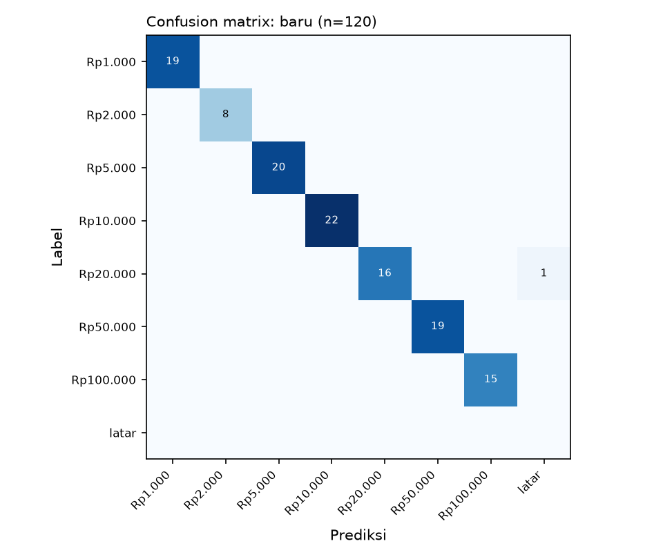

<details><summary>Per kelas: lusuh_kusut</summary>

| Kelas | Precision | Recall | F1 | Dukungan |
|---|---|---|---|---|
| Rp1.000 | 0,913 | 0,955 | 0,933 | 22 |
| Rp2.000 | 1,000 | 0,975 | 0,987 | 40 |
| Rp5.000 | 1,000 | 0,965 | 0,982 | 57 |
| Rp10.000 | 0,958 | 0,852 | 0,902 | 27 |
| Rp20.000 | 1,000 | 1,000 | 1,000 | 13 |
| Rp50.000 | 1,000 | 1,000 | 1,000 | 27 |
| Rp100.000 | 1,000 | 1,000 | 1,000 | 15 |

</details>

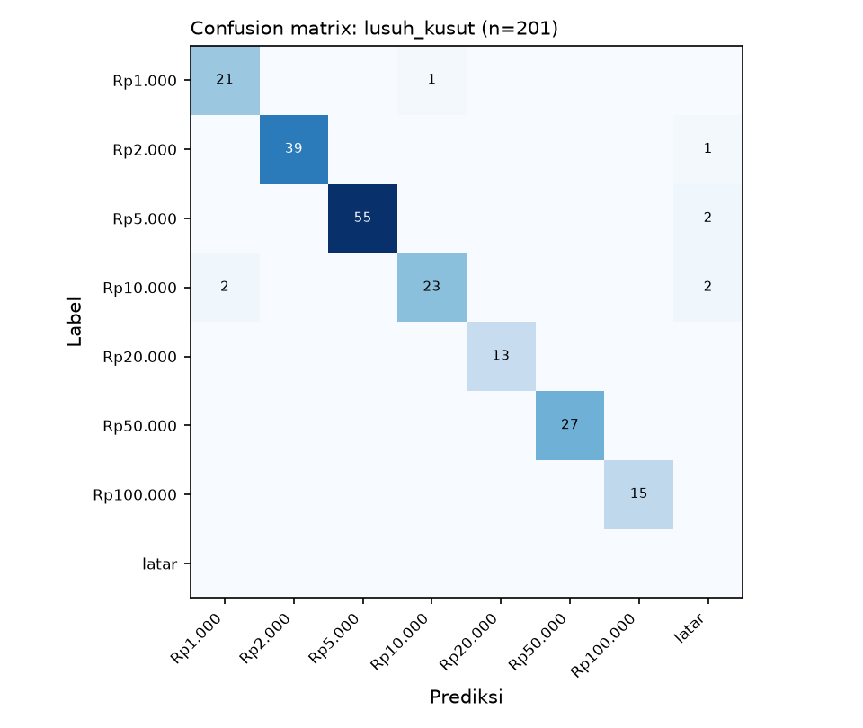

<details><summary>Per kelas: terlipat_tertutup</summary>

| Kelas | Precision | Recall | F1 | Dukungan |
|---|---|---|---|---|
| Rp1.000 | 1,000 | 0,966 | 0,983 | 29 |
| Rp2.000 | 0,889 | 0,842 | 0,865 | 19 |
| Rp5.000 | 1,000 | 0,833 | 0,909 | 12 |
| Rp10.000 | 1,000 | 0,750 | 0,857 | 8 |
| Rp20.000 | 0,867 | 0,812 | 0,839 | 16 |
| Rp50.000 | 1,000 | 0,900 | 0,947 | 20 |
| Rp100.000 | 1,000 | 0,938 | 0,968 | 16 |

</details>

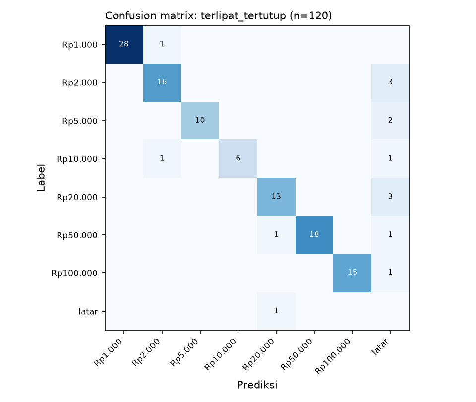

<details><summary>Per kelas: cahaya_redup</summary>

| Kelas | Precision | Recall | F1 | Dukungan |
|---|---|---|---|---|
| Rp1.000 | 1,000 | 0,882 | 0,938 | 17 |
| Rp2.000 | 1,000 | 1,000 | 1,000 | 29 |
| Rp5.000 | 1,000 | 1,000 | 1,000 | 12 |
| Rp10.000 | 1,000 | 1,000 | 1,000 | 29 |
| Rp20.000 | 1,000 | 0,857 | 0,923 | 14 |
| Rp50.000 | 1,000 | 1,000 | 1,000 | 12 |
| Rp100.000 | 1,000 | 1,000 | 1,000 | 12 |

</details>

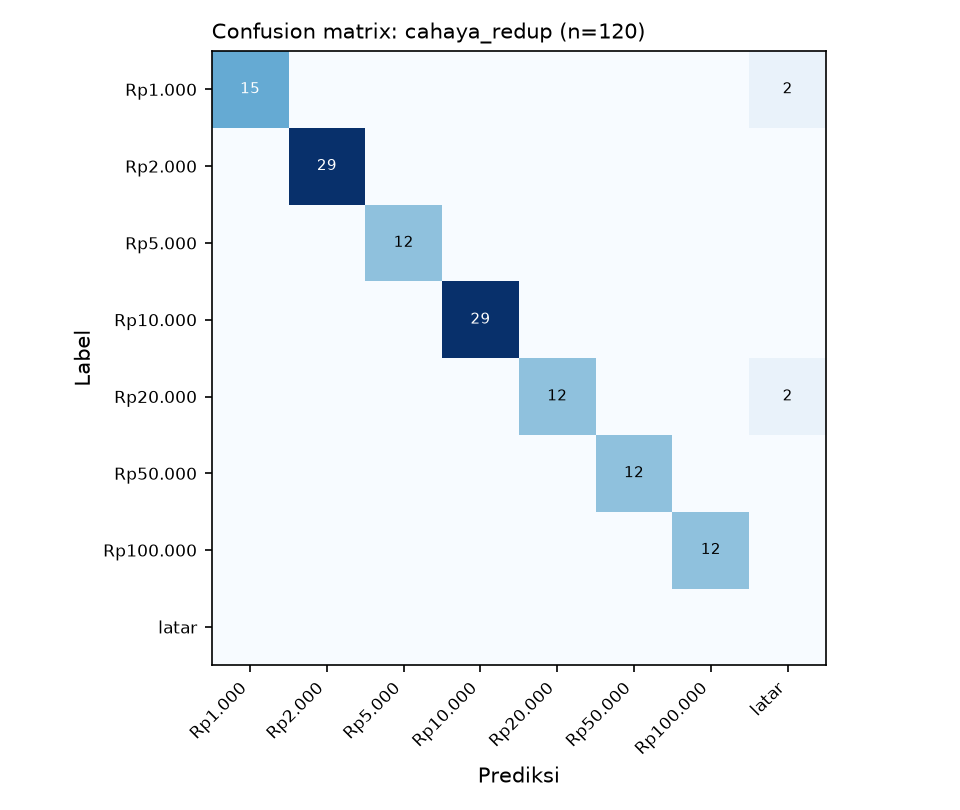

<details><summary>Per kelas: latar_ramai</summary>

| Kelas | Precision | Recall | F1 | Dukungan |
|---|---|---|---|---|
| Rp1.000 | 1,000 | 1,000 | 1,000 | 8 |
| Rp2.000 | 0,917 | 0,868 | 0,892 | 38 |
| Rp5.000 | 1,000 | 0,556 | 0,714 | 9 |
| Rp10.000 | 0,769 | 0,625 | 0,690 | 16 |
| Rp20.000 | 0,500 | 0,364 | 0,421 | 11 |
| Rp50.000 | 0,882 | 0,789 | 0,833 | 19 |
| Rp100.000 | 1,000 | 0,727 | 0,842 | 22 |

</details>

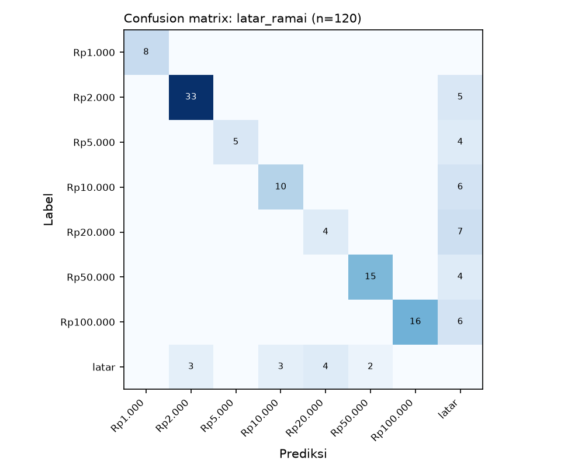

<details><summary>Per kelas: bukan_rupiah</summary>

| Kelas | Precision | Recall | F1 | Dukungan |
|---|---|---|---|---|
| Rp2.000 | 0,000 | 0,000 | 0,000 | 0 |
| Rp5.000 | 0,000 | 0,000 | 0,000 | 0 |
| Rp10.000 | 0,000 | 0,000 | 0,000 | 0 |
| Rp20.000 | 0,000 | 0,000 | 0,000 | 0 |
| Rp50.000 | 0,000 | 0,000 | 0,000 | 0 |
| Rp100.000 | 0,000 | 0,000 | 0,000 | 0 |

</details>

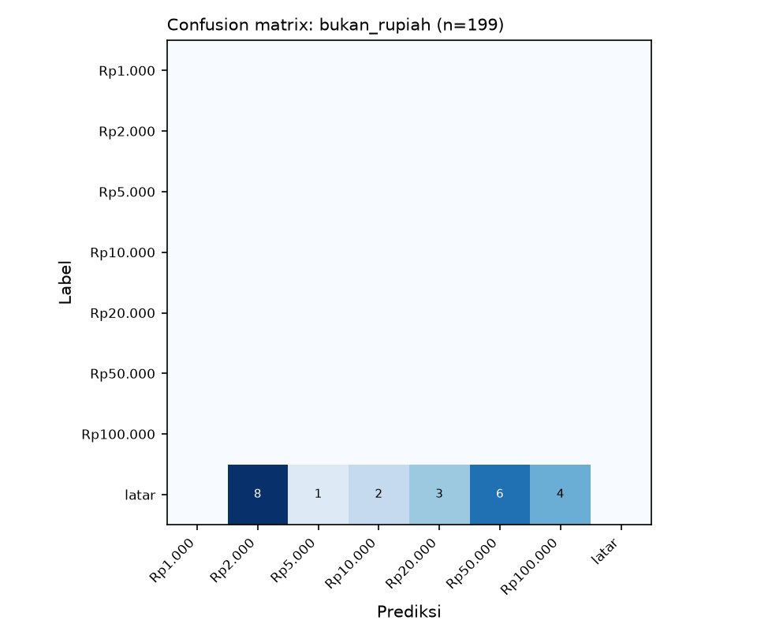

<details><summary>Per kelas: baru_pindaian</summary>

| Kelas | Precision | Recall | F1 | Dukungan |
|---|---|---|---|---|
| Rp1.000 | 1,000 | 1,000 | 1,000 | 3 |
| Rp2.000 | 1,000 | 1,000 | 1,000 | 17 |
| Rp5.000 | 1,000 | 1,000 | 1,000 | 26 |
| Rp10.000 | 1,000 | 1,000 | 1,000 | 5 |
| Rp20.000 | 1,000 | 1,000 | 1,000 | 4 |
| Rp50.000 | 1,000 | 1,000 | 1,000 | 21 |
| Rp100.000 | 1,000 | 1,000 | 1,000 | 23 |

</details>

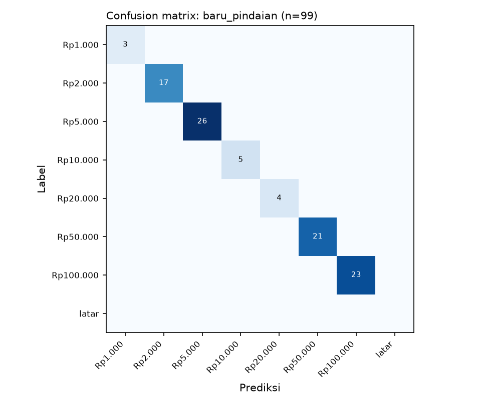

Pembanding: model percobaan `model-v2-fp16.onnx` (ronde v2 hard negative, **tidak diadopsi**) pada set yang sama. "Salah sebut" = ada nominal diumumkan yang tidak ada di citra; "diam" = tidak ada deteksi ≥ ambang.

| Kondisi | Akurasi `model-v1-fp16.onnx` | Akurasi `model-v2-fp16.onnx` | Salah sebut | Diam |
|---|---|---|---|---|
| baru | 0,992 | 0,992 | 0 → 0 | 1 → 1 |
| lusuh_kusut | 0,960 | 0,950 | 3 → 3 | 5 → 7 |
| terlipat_tertutup | 0,892 | 0,842 | 3 → 1 | 10 → 18 |
| cahaya_redup | 0,967 | 0,908 | 0 → 0 | 4 → 11 |
| latar_ramai | 0,842 | 0,883 | 1 → 1 | 17 → 12 |
| bukan_rupiah | 0,889 | 0,995 | 22 → 1 | 0 → 0 |
| baru_pindaian | 1,000 | 0,970 | 0 → 0 | 0 → 3 |
| **Jumlah** | | | **29 → 6** | **37 → 52** |

## 4.6 Perbandingan FP32, FP16, INT8

Evaluasi split test dengan backend onnxruntime (CPU), pipeline evaluasi sama untuk semua varian. Kolom "validator" = validator Ultralytics (letterbox persegi); kolom "web" = pipeline aplikasi (`eval_onnx_map.py`).

| Varian | Ukuran (MB) | mAP50 validator | mAP50-95 validator | mAP50 web | mAP50-95 web | Precision validator | Recall validator | ms/citra (CPU Kaggle) |
|---|---|---|---|---|---|---|---|---|
| fp32 | 12,14 | 0,9285 | 0,6801 | 0,9154 | 0,6771 | 0,9281 | 0,8860 | 15,1 |
| fp16 | 6,11 | 0,9286 | 0,6800 | 0,9154 | 0,6773 | 0,9283 | 0,8865 | 15,9 |
| int8 | 3,38 | 0,8760 | 0,6481 | 0,8770 | 0,6539 | 0,9440 | 0,8197 | 15,0 |
| int8_mixed | 5,58 | 0,9147 | 0,6633 | 0,8997 | 0,6590 | 0,9127 | 0,8710 | 23,9 |

Aturan pemilihan: terkecil dengan drop mAP50 <= 1 poin. Terpilih: **fp16**.

### Pembahasan kuantisasi

- **FP16** (`onnxruntime.transformers.float16`, input/output tetap float32) memangkas ukuran dari 12,14 MB menjadi
  6,11 MB tanpa penurunan akurasi: mAP50 pipeline web sama, 0,9154. Operator `Resize` harus dibiarkan FP32 karena
  input `scales`-nya wajib float32. Tanpa pengecualian ini, model hasil konversi tidak valid.
- **INT8 penuh** (kuantisasi statis QDQ per-channel, kalibrasi citra train) adalah yang terkecil (3,38 MB), tetapi
  mAP50 web turun ke 0,8770 dan recall ke 0,82. Penyebabnya, keluaran YOLOv8 menggabungkan koordinat box (0 sampai
  320 piksel) dan skor kelas (0 sampai 1) dalam satu tensor, sehingga satu skala kuantisasi merusak resolusi skor
  kelas. Pada model imgsz 416 efeknya jauh lebih parah: recall INT8 hanya 0,014. Kuantisasi per-channel juga
  mengharuskan graf dinaikkan dari opset 12 ke 13.
- **INT8 campuran** (head deteksi `/model.22/*` tetap FP32) memulihkan sebagian besar akurasi (mAP50 web 0,8997),
  tetapi masih turun 1,6 poin dibanding FP32. Ukurannya juga hanya 0,53 MB lebih kecil dari FP16, dan di CPU Kaggle
  justru lebih lambat (23,9 vs 15,9 ms/citra) karena banyak operasi kuantisasi/dekuantisasi.
- Sesuai aturan "varian terkecil dengan penurunan mAP50 ≤ 1 poin", **FP16 dipilih** sebagai model web.


## 4.7 Performa aplikasi web

| Aset unduhan pertama | Ukuran |
|---|---|
| HTML/JS/CSS/service worker | 0.13 MB mentah / 0.05 MB gzip |
| Runtime ONNX (WASM) | 14.24 MB mentah / 3.70 MB gzip |
| Audio (klip + manifest) | 1.53 MB mentah / 1.44 MB gzip |
| Ikon | 0.02 MB mentah / 0.02 MB gzip |
| Model ONNX | 6.11 MB mentah / 5.61 MB gzip |
| TOTAL unduhan pertama | 22.03 MB mentah / 10.81 MB gzip |

Benchmark desktop (halaman `/benchmark`, Chrome, backend WASM):

```json
{
 "perangkat": "Desktop Intel Core i7-4770S (4 core/8 thread, 2013), 16 GB RAM, Windows 10, Google Chrome 155 headless",
 "tanggal": "2026-10-20T06:56:01.467Z",
 "catatan": "halaman /benchmark?auto=1 dari build produksi (vite preview), backend WASM 1 thread (tanpa COOP/COEP seperti GitHub Pages), 50 iterasi pada 3 foto contoh",
 "hasil": [
  {
   "model": "model-v1-fp16.onnx",
   "imgsz": 320,
   "ort": "1.30.0",
   "backend": "wasm",
   "threads": 1,
   "crossOriginIsolated": false,
   "offscreenWorker": true,
   "hardwareConcurrency": 8,
   "userAgent": "Mozilla/5.0 (Windows NT 10.0; Win64; x64) AppleWebKit/537.36 (KHTML, like Gecko) HeadlessChrome/155.0.0.0 Safari/537.36",
   "iterations": 50,
   "model_download_ms": 403.8,
   "model_load_total_ms": 1144.3,
   "session_init_ms": 465.2,
   "warmup_ms": 235.1,
   "preprocess_ms": 1.5,
   "inference_ms": {
    "mean": 133.4,
    "median": 130,
    "p95": 161.2,
    "min": 118.6
   },
   "postprocess_ms": 0.1,
   "end_to_end_ms": {
    "mean": 139.2,
    "p95": 166.7
   },
   "fps": 7.2
  }
 ]
}
```

| Lighthouse | Skor |
|---|---|
| url | https://apanzagg.github.io/rupiah-vision/ |
| tanggal | 2026-10-22T02:15:33.815Z |
| lighthouse | 13.5.0 |
| perangkat | emulasi seluler Lighthouse (Moto G Power, throttling 4G lambat), dijalankan dari desktop i7-4770S |
| Performance | 99 |
| Accessibility | 100 |
| Best Practices | 100 |
| SEO | 100 |
| First Contentful Paint | 1.2 s |
| Largest Contentful Paint | 1.2 s |
| Total Blocking Time | 0 ms |
| Cumulative Layout Shift | 0 |

### Pembahasan performa

- **Unduhan pertama** 10,81 MB terkompresi gzip (22,03 MB mentah). Komponen terbesar adalah model (5,61 MB gzip) dan
  runtime ONNX WASM (3,70 MB gzip). Setelah kunjungan pertama, semua aset disajikan dari cache service worker, jadi
  aplikasi berjalan **offline**.
- **Kecepatan inferensi** di desktop Intel i7-4770S (2013), Chrome, backend WASM: median 130 ms per frame (p95 161 ms),
  end-to-end sekitar 139 ms, atau sekitar **7 FPS**. WASM berjalan **1 thread** karena GitHub Pages tidak mengirim
  header COOP/COEP, sehingga halaman tidak `crossOriginIsolated` dan multi-thread WASM tidak tersedia. Dengan aturan
  konsistensi 3 dari 5 frame, nominal diumumkan kira-kira 0,4 sampai 0,7 detik setelah uang stabil di depan kamera.
- **Waktu muat** (build produksi lokal sampai model siap): kunjungan pertama 2,0 detik, dari cache 1,0 detik, offline
  0,95 detik. Aplikasi lolos kriteria instalasi PWA Chrome tanpa error manifest.
- **Lighthouse** dari URL publik, dengan emulasi ponsel Moto G Power dan throttling jaringan/CPU: Performance 99,
  Accessibility 100, Best Practices 100, SEO 100.
- **Verifikasi deploy publik** (22 Oktober 2026): uji E2E dengan kamera palsu terhadap
  https://apanzagg.github.io/rupiah-vision/ lulus untuk pengumuman multi-lembar, panduan "uang belum terdeteksi", dan
  pengumuman setelah reload **tanpa jaringan**.
- **Belum diukur:** kecepatan di ponsel nyata. CPU ponsel kelas menengah umumnya lebih lambat daripada desktop ini,
  sehingga FPS di ponsel perlu diukur sendiri lewat halaman `/benchmark/`.


## 4.8 Contoh deteksi benar dan salah

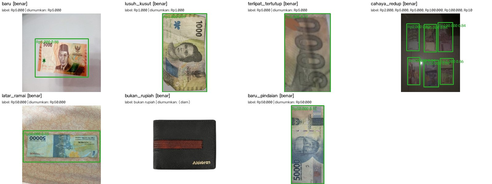

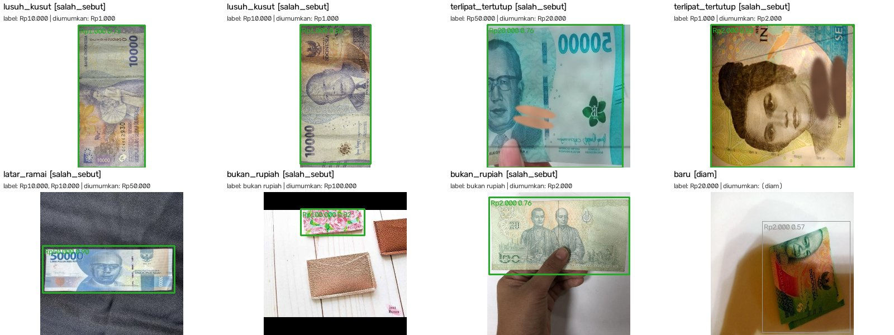

### Analisis kesalahan

Kesalahan model web v1 pada set uji per kondisi (1.079 citra, ambang 0,7) terbagi menjadi dua jenis yang dampaknya
berbeda bagi pengguna tunanetra:

**Salah sebut (29 citra): ada nominal yang diumumkan tetapi tidak ada di citra.** Ini kesalahan paling berbahaya.
- 22 citra **uang asing** diumumkan sebagai rupiah dengan skor 0,70 sampai 0,92: real Brasil biru menjadi
  Rp50.000/Rp2.000, baht Thailand menjadi Rp2.000/Rp100.000, kip Laos menjadi Rp20.000. Penyebabnya, data train hanya
  memuat 258 citra uang asing sebagai negatif. Warna dan tata letak uang asing itu mirip nominal rupiah tertentu,
  sedangkan menaikkan ambang tidak efektif karena skornya tinggi.
- 3 citra **lusuh** tertukar Rp10.000 ↔ Rp1.000, pola "beda satu nol" yang juga ditemukan sebagai salah label di
  beberapa sumber data. Kemungkinan sisa label keliru di data latih ikut terpelajari.
- 3 citra **terlipat/tertutup** (Rp50.000 → Rp20.000, Rp1.000 → Rp2.000, Rp10.000 → Rp2.000): bagian pembeda (angka,
  warna utama) tertutup jari atau lipatan.
- 1 citra latar ramai ternyata **salah label di set uji**: dilabeli 2 lembar Rp10.000, padahal fotonya selembar
  Rp50.000. Model mengumumkan Rp50.000 dengan benar. Akurasi `latar_ramai` sebenarnya sedikit lebih tinggi daripada
  yang tercatat.

**Diam (37 citra): uang ada, tetapi tidak ada deteksi dengan skor ≥ 0,7.** Kesalahan ini lebih aman karena aplikasi
memberi panduan suara "uang belum terdeteksi" dan pengguna bisa menggeser kamera. Kasus terbanyak ada di latar ramai
(17 citra, umumnya uang kecil di lantai bermotif dengan kelas benar tetapi skor 0,5 sampai 0,7) dan di terlipat/tertutup
(10 citra).

**Percobaan perbaikan (ronde v2).** Fine-tune dengan 1.770 negatif tambahan, uang asing di-oversample 3x, mengurangi
salah sebut dari 29 menjadi 6, dan akurasi uang asing naik dari 0,889 ke 0,995. mAP50 pipeline web juga naik ke 0,9304.
Namun kasus diam naik dari 37 menjadi 52, terutama pada citra redup (−5,8 poin) dan terlipat (−5,0 poin). Karena
melanggar aturan adopsi yang ditetapkan sebelum hasil keluar ("kondisi lain turun ≤ 3 poin"), v2 **tidak dipakai**.
Kompromi ini menunjukkan arah perbaikan berikutnya: kalibrasi ambang per model pada split val, atau penambahan data
positif terlipat/redup bersamaan dengan negatif uang asing.


## 4.9 Keterbatasan sistem

- **Hanya mengenali nominal, tidak memeriksa keaslian.** Uang palsu yang mirip tetap akan disebut nominalnya.
- **Ruang lingkup:** 7 nominal uang kertas emisi 2016 dan 2022. Uang logam, Rp75.000, dan emisi lama tidak dikenali
  atau belum diuji.
- **Uang asing masih bisa disebut sebagai rupiah**: 11% citra uang asing pada set uji (22 dari 199) salah diumumkan.
  Ronde v2 memperbaikinya, tetapi mengorbankan deteksi uang terlipat/redup, sehingga belum dipakai.
- **Set uji kondisi sebagian sintetis.** `terlipat_tertutup` seluruhnya dibuat dengan oklusi jari dan lipatan buatan
  pada citra test. Angka kondisi ini bukan pengganti uji lapangan.
- **Belum ada uji lapangan dengan pengguna tunanetra** dan belum ada pengukuran di ponsel Android/iPhone nyata. Semua
  angka kecepatan berasal dari desktop dan emulasi Lighthouse.
- **Kualitas label dataset publik.** Sumber Roboflow memuat salah label (pola "salah jumlah nol"). Sebagian sudah
  dikoreksi, tetapi 63 kasus di val/test dibiarkan, dan set uji per kondisi juga memuat sedikitnya satu label keliru.
- **Kinerja di browser terbatas 1 thread WASM** karena GitHub Pages tidak mendukung header COOP/COEP. Hosting dengan
  header tersebut akan mengaktifkan multi-thread.
- **Selisih protokol evaluasi:** validator Ultralytics bawaan (`rect=True`) memberi mAP50 sekitar 4 poin lebih tinggi
  daripada pipeline aplikasi untuk model yang sama. Laporan ini memakai angka pipeline aplikasi sebagai angka utama.

